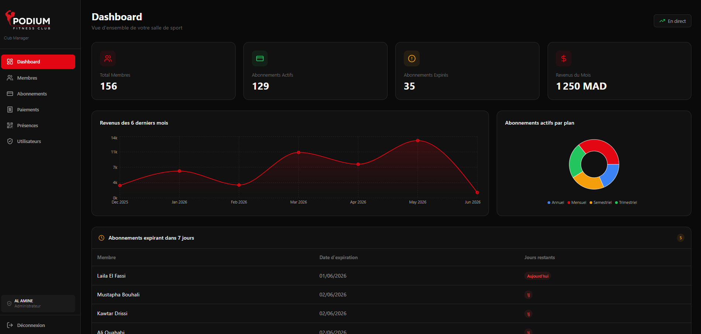
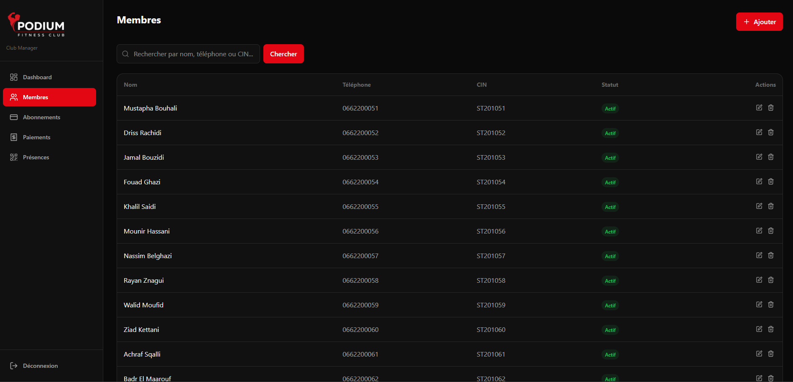
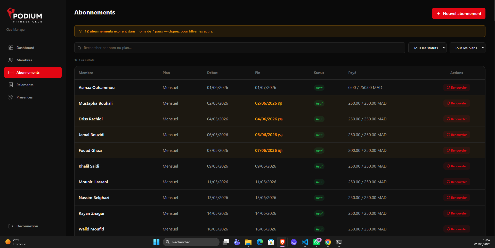
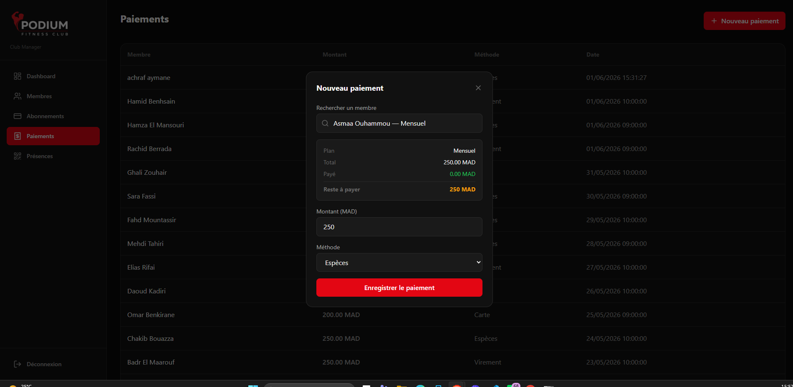
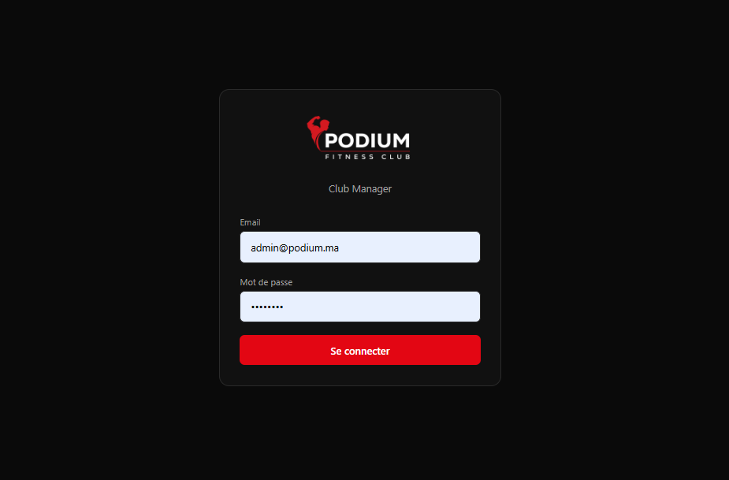

# Podium Club Manager

Podium Club Manager is a web application for managing day-to-day operations at a fitness club. It provides a React interface backed by an Express API and a MySQL database.

## Features

- Dashboard with member and subscription totals, monthly revenue, revenue trends, subscription-plan breakdowns, and upcoming expirations.
- Member records with search, profile details, create/edit/delete actions, status tracking, and CSV export.
- Subscription management with predefined plans, renewals, and payment balances.
- Payment recording with cash, card, and transfer methods.
- Attendance check-ins and recent attendance history.
- User administration for admins, with page access controlled by role (admin, cashier, receptionist, and coach).
- JWT-based sign-in and protected API routes.

## Screenshots

### Dashboard



### Member Directory



### Subscription Management



### Payment Entry



### Sign-In



## Tech Stack

- Frontend: React 19, React Router, Vite, Tailwind CSS, Axios, Recharts, date-fns, and Lucide React.
- Backend: Node.js, Express, MySQL (`mysql2`), JWT, and bcryptjs.
- Security middleware: Helmet and CORS.

## Requirements

- Node.js and npm.
- MySQL Server and a MySQL command-line client or a database GUI such as MySQL Workbench.

There is no root-level `package.json`; install and run the client and server packages separately.

## Setup

1. Clone the repository and enter its directory:

   ```bash
   git clone https://github.com/AtrassiOthmane19/podium-club-manager.git
   cd podium-club-manager
   ```

2. Create the database by executing `server/database/schema.sql` with your MySQL client. This creates the `podium_manager` database and the initial subscription plans. To enable the cashier and coach roles, also execute `server/database/add_roles.sql` after the schema.

3. Create the server environment file by copying `server/.env.example` to `server/.env`, then set the values for your local environment. The server reads `DB_HOST`, `DB_USER`, `DB_PASSWORD`, `DB_NAME`, and `JWT_SECRET`; `PORT` and `CLIENT_ORIGIN` are optional. Use a strong, private JWT secret and do not commit `.env`.

   PowerShell:

   ```powershell
   Copy-Item server/.env.example server/.env
   ```

   macOS/Linux/Git Bash:

   ```bash
   cp server/.env.example server/.env
   ```

4. Install dependencies for both packages:

   ```bash
   cd client
   npm install
   cd ../server
   npm install
   ```

5. Create an administrator account before signing in. The current `server/createAdmin.js` helper contains hard-coded demo account values. Replace them with credentials you choose before running the helper; do not use its defaults in an exposed environment. Then, from the `server` directory, run:

   ```bash
   npm run create-admin
   ```

## Run Locally

For development, start the API and Vite client in separate terminals from the repository directory.

API terminal:

```bash
cd server
npm run dev
```

Client terminal:

```bash
cd client
npm run dev
```

Open the local URL printed by Vite (typically `http://localhost:5173`). The Vite development server proxies `/api` requests to the API on port `5000`.

For a built frontend served by Express instead, build the client and start the server:

```bash
cd client
npm run build
cd ../server
npm start
```

Then open `http://localhost:5000`. On Windows, the repository also includes `start.ps1`, which builds the client and starts the server after dependencies and environment settings are in place. Run it from the project root with `.\start.ps1` in PowerShell.

## Project Status

The features listed above are present in the application source. Neither package currently defines an automated test script, so changes should be verified by running the relevant workflows locally. This README does not imply production readiness.

## License

No license is currently specified in this repository.